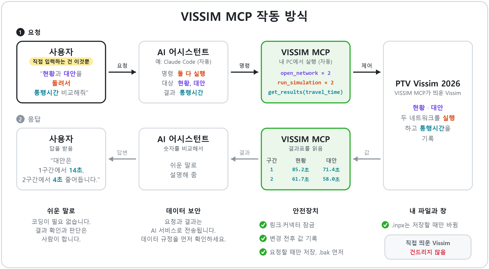

# VISSIM MCP

[English](README.md) · **한국어** · [简体中文](README.zh-CN.md)

Claude Code 같은 AI 어시스턴트가 COM으로 **PTV Vissim 2026**을 조작하게 해 주는 로컬 [MCP](https://modelcontextprotocol.io) 서버입니다. 실제 과업 파일을 다루면서도 파일을 망가뜨리지 않도록 만들었습니다.

> **AI로 만든, 한 사람의 업무용 도구입니다.** 작성자가 자기 Vissim 업무를 편하게 하려고 AI 코딩 도구로 만들었고, 기능은 필요할 때마다 덧붙였습니다. 작성자의 PC와 과업에서만 시험했으며 다른 환경에서는 시험하지 않았습니다. AI 어시스턴트의 도움을 받아 쓰기를 권합니다. 이 저장소를 읽히고, 쓰는 Vissim 버전과 환경에 맞는지 확인하게 한 뒤, 맞지 않는 부분을 고쳐 쓰세요.

## 전체 흐름에서의 위치

작성자의 Vissim 작업은 세 단계입니다. 이 저장소는 2단계를 공개합니다.

| 단계 | 하는 일 | 이 저장소 |
|---|---|---|
| 1. 네트워크 구축 | Vissim 네트워크 생성 | 비공개 |
| 2. **대화형 조작(MCP)** | AI 어시스턴트가 네트워크를 열고, 고치고, 시뮬레이션하고, 결과를 읽음 | **전체 소스 공개** |
| 3. 정산 및 검증 자동화 | — | 이름만 |

## 작동 방식



## 보장하는 것

- **자기가 띄운 Vissim만 조작합니다.** 사용자가 직접 연 Vissim 창에는 붙지 않으므로, 거기서 작업 중인 네트워크는 건드리지 않습니다.
- **끌 수 없는 보호 목록이 있습니다.** 링크·커넥터의 생성·삭제·선형 변경은 거부하고, 기준점·단위·통행 방향·경사 기준 변경도 거부합니다. 검사는 COM 호출 전에 하므로 막힌 호출은 Vissim에 닿지 않습니다.
- **저장하라고 할 때만 저장합니다.** 자동 저장은 없습니다. 저장할 때마다 먼저 `.bak` 사본을 씁니다. 다른 Vissim 프로세스가 떠 있으면 확인 없이는 저장을 거부합니다.
- **모든 변경을 기록합니다.** 쓰기마다 변경 전후 값을 돌려주고 `changes.jsonl`에 남깁니다. 저장하지 않은 변경이 있는 채로 끄면 먼저 묻고, 복구 사본을 남깁니다.
- **로컬에서만 돕니다.** `127.0.0.1`에서만 듣고, 다른 주소로 바꾸는 설정은 없습니다.

> **면책.** 이 프로젝트는 PTV Group과 관계없는 독립 프로젝트이며 PTV Group의 승인을 받지 않았습니다. "PTV"와 "Vissim"은 PTV Planung Transport Verkehr GmbH의 상표입니다. PTV Vissim 정품 라이선스가 필요합니다. Vissim 자료나 결과를 AI 어시스턴트 같은 외부 서비스로 보내는 것에 관한 조항을 포함해, PTV 라이선스 조건을 지킬 책임은 사용자에게 있습니다. 이 저장소에는 PTV 소프트웨어·문서·예제 파일이 들어 있지 않습니다. README의 아이콘 그림은 PTV Vissim 2026 아이콘에서 만든 것으로, 이 도구가 사용자 PC에서 그리는 아이콘을 알아보게 하려는 용도로만 싣습니다.

## 상태

- Windows 11, Python 3.12, PTV Vissim 2026 (SP09)에서 시험했습니다. 다른 Vissim 버전은 시험하지 않았습니다. COM ProgID는 설정에서 바꿀 수 있습니다. 다른 버전에서 쓰기 전에 아래 점검 도구를 먼저 돌리세요.
- 참고용으로 있는 그대로 공개합니다. 지원 약속은 없고, 인터페이스는 예고 없이 바뀔 수 있으며, 이슈·풀 리퀘스트에 답하지 못할 수 있습니다.
- `git clone`으로만 배포합니다. PyPI에는 없습니다.

## 필요한 것

- 정품 **PTV Vissim 2026**이 설치된 Windows (COM은 Windows 전용)
- Python 3.12 이상
- streamable HTTP 전송을 지원하는 MCP 클라이언트 (예: [Claude Code](https://claude.com/claude-code))

## 설치

```bash
git clone https://github.com/sn856/VISSIM_MCP.git
cd VISSIM_MCP
python -m pip install -e .
```

## 처음 실행

1. **PC에서 COM을 한 번 점검합니다.** 점검 도구는 빈 네트워크를 만들어 서버가 쓰는 호출을 하나씩 시도하고, 항목마다 OK 또는 Vissim 오류 문구를 출력합니다. 사용자 네트워크는 저장하지 않습니다. 저장된 네트워크를 `--net`으로 주면 시뮬레이션·결과 점검도 합니다.

   ```bash
   python tools/com_probe.py --net C:\path\to\some\network.inpx
   ```

2. **Claude Code에 서버를 등록합니다** (user 범위라 어느 세션에서든 보입니다).

   ```bash
   claude mcp add --scope user --transport http vissim http://127.0.0.1:8766/mcp
   ```

3. **서버를 띄웁니다.** 콘솔 창 없이 시스템 트레이에 뜹니다. Vissim은 첫 명령 때 뜹니다.

   ```bash
   python -m vissim_mcp
   ```

   상태는 `python -m vissim_mcp status`로 봅니다. 끌 때는 트레이 아이콘의 종료 메뉴나 `python -m vissim_mcp stop`을 씁니다.

## 더블클릭으로 열기 (선택)

COM은 사용자가 직접 띄운 Vissim 창에 붙지 못합니다. 그래서 모든 Vissim 창을 조작할 수 있게 하려면 파일을 서버를 *거쳐서* 열어야 합니다. 명령 하나로 현재 Windows 사용자 계정에 설정합니다.

```bash
python -m vissim_mcp install
```

세 가지를 바꾸고, 각각을 `%LOCALAPPDATA%\vissim_mcp\install.json`에 기록합니다.

- **`.inpx` 더블클릭**이 서버의 Vissim에서 파일을 엽니다. 서버가 꺼져 있으면 켭니다. 다른 파일이 열려 있으면 바꾸기 전에 묻습니다. Vissim은 저장하지 않은 변경을 묻지 않고 버리기 때문입니다. Vissim 자체의 "열기"는 오른쪽 클릭 메뉴에 그대로 남습니다.
- **바탕화면 바로가기 "VISSIM MCP"**가 빈 Vissim으로 서버를 띄웁니다. 서버의 Vissim이 이미 떠 있으면 새로 띄우지 않고 그 창을 앞으로 가져옵니다.
- **시작프로그램 바로가기**가 로그인할 때 서버를 띄워, 세션을 열자마자 어시스턴트가 붙을 수 있게 합니다.

### 아이콘 세 가지


| 아이콘 | 보이는 곳 | 하는 일 |
|---|---|---|
|  | 바탕화면 바로가기 **VISSIM MCP** | 빈 Vissim으로 서버를 띄웁니다. 서버의 Vissim이 이미 떠 있으면 새로 띄우지 않고 그 창을 앞으로 가져옵니다. |
|  | 탐색기의 모든 `.inpx` 파일 | 더블클릭하면 서버의 Vissim에서 열고, 서버가 꺼져 있으면 켭니다. 오른쪽 클릭 메뉴에 **Open with VISSIM MCP**도 생기고, Vissim 자체의 "열기"로 서버 없이 여는 것도 그대로 됩니다. |
|  | 서버가 도는 동안 시스템 트레이(알림 영역) | 클릭: **Show status**(상태 보기). 오른쪽 클릭 메뉴: **Show status**, **Open log folder**(로그 폴더 열기), **Quit server and VISSIM**(서버와 Vissim 끄기). 저장하지 않은 변경이 있으면 끄기 전에 묻습니다. |

위 그림은 PTV Vissim 2026 (SP09) 아이콘으로 그린 실제 아이콘입니다. 이 도구는 아이콘 파일을 함께 배포하지 않고, 사용자 PC에 설치된 Vissim 아이콘으로 그때그때 그립니다. 보라색 바탕이 초록색으로 바뀌고, 트레이는 큰 "V" 한 글자, 바로가기는 "Vis / MCP" 두 줄이며, `.inpx` 아이콘은 Vissim 원래 글자("Vsi 26")를 그대로 둡니다. 아이콘마다 글자도 달라서 색만으로 구분할 필요는 없습니다. Vissim 아이콘을 읽지 못하면 트레이는 "V"가 그려진 초록 원으로 대신합니다.

`python -m vissim_mcp uninstall`은 `install.json`에 적힌 것만 정확히 지웁니다. 시작 메뉴에서 띄운 Vissim은 여전히 어시스턴트가 닿지 못하는 일반 Vissim이니, 바로가기나 더블클릭을 쓰세요.

## 쓰는 법

### 매일 작업할 때

1. **작업하는 동안 트레이 아이콘을 켜 둡니다.**  트레이 아이콘이 곧 서버입니다. 이게 없으면 어시스턴트가 말을 걸 곳이 없습니다. `install`을 해 두었다면 로그인할 때 저절로 켜지고, 아니면 바탕화면 바로가기나 `python -m vissim_mcp`로 켭니다. 트레이에서 끄면 서버가 띄운 Vissim도 같이 닫히고, 저장하지 않은 변경이 있으면 먼저 묻습니다.
2. **Vissim은 서버를 거쳐 엽니다.**
   -  네트워크 작업은 초록색 `.inpx` 파일을 평소처럼 더블클릭하면 됩니다.
   -  빈 Vissim에서 시작하려면 바탕화면의 **VISSIM MCP** 바로가기를 실행합니다. Vissim이 켜지고 어시스턴트가 조작할 수 있는 상태가 됩니다.
   - 시작 메뉴나 Vissim 자체 아이콘으로 열지 마세요. 그렇게 연 Vissim도 평소대로 쓸 수는 있지만 어시스턴트가 닿지 못합니다.
3. **Claude Code를 서버에 연결합니다.** 등록은 한 번만 하면 됩니다(`claude mcp add ...`, [처음 실행](#처음-실행) 참고). 그다음부터는 아무 폴더에서나 Claude Code를 열고 `/mcp`를 입력해, `vissim`이 연결됨(connected)으로 보이는지 확인합니다. 세션을 연 뒤에 서버를 켰다면 같은 `/mcp` 화면에서 `vissim`을 다시 연결합니다.
4. **어시스턴트에게 말로 지시합니다**(아래 예). 다 끝나면 "저장해"라고 한 뒤 트레이 아이콘에서 끕니다.

### 이렇게 말하면 됩니다

어시스턴트에게 평소 말로 지시합니다. 예:

1. "`C:\projects\corridor\network.inpx` 열어."
2. "차량입력 3번 교통량을 2000대/시로 바꿔."
3. "10분 돌려."
4. "통행시간 보여 줘."
5. "저장해."

파일은 5번에서만 바뀌고, 그 전에 `.bak` 사본을 씁니다.

서버는 다음 경우에 이유를 말하고 거부합니다.

- 파일이 열려 있는데 다른 파일을 열려 할 때 ("버리고 열어"라고 답하면 엽니다)
- 다른 Vissim 창이 떠 있는데 저장하려 할 때 (그 창을 닫거나 `force`로 확인)
- 시뮬레이션이 도는 중에 무언가를 바꾸려 할 때 (먼저 멈춤)
- 보호 항목을 바꾸려 할 때 (불가. 목록은 설정 파일로만 바꿀 수 있습니다)

## 도구 (20개)

| 묶음 | 도구 |
|---|---|
| 세션 | `vissim_status`, `open_network`, `save_network` |
| 객체 | `list_object_types`, `describe_attributes`, `list_objects`, `get_attributes`, `set_attributes`, `create_object`, `delete_object` |
| 시뮬레이션 | `configure_simulation`, `configure_evaluation`, `run_simulation`, `stop_simulation` |
| 결과 | `get_results`, `list_result_files`, `read_result_file` |
| 기록 | `get_change_log` |
| 화면 | `set_view`, `capture_view` |

차량입력, 차종구성, 정적 경로, 희망속도결정, 감속구역, 데이터 수집 지점·측정, 통행시간 측정, 대기행렬 계수기, 주차 객체를 만들고 지울 수 있습니다. 모든 응답에는 열린 파일, 저장하지 않은 쓰기 수, 시뮬레이션 상태를 담은 `state` 묶음이 붙습니다. 인자와 반환 모양은 [docs/contracts.md](docs/contracts.md)(영어)에 있습니다.

`python tools/mcp_call.py`는 같은 도구를 명령줄에서 부릅니다. 어시스턴트 세션의 MCP 연결이 끊겼을 때 쓸모가 있습니다.

## 설정

설정 파일은 `config/vissim_mcp.json`입니다. 다른 파일은 `--config`로 줍니다.

| 키 | 뜻 |
|---|---|
| `vissim.progid` | COM ProgID. Vissim 2026은 `Vissim.Vissim.26` |
| `port` | 로컬 포트 (기본 8766) |
| `protected` | 보호 목록. `{type, ops, attrs}` 항목들. `attrs: ["*"]`는 모든 속성, 끝의 `*`는 앞부분 일치 |
| `protected_roots` | 이 폴더 아래 파일은 `.bak`을 파일 옆이 아니라 `log_root/backup/`에 씁니다. 자료 폴더가 사본으로 차지 않게 |
| `log_root` | 로그·백업·복구 사본·레이아웃·화면 캡처를 두는 곳 (기본 `runs/mcp`) |

나머지 조정값과 기본값은 [`src/vissim_mcp/config.py`](src/vissim_mcp/config.py)에 있습니다.

## 서버가 쓰는 파일

- 서버의 Vissim에 열린 `.inpx`. `save_network`를 부르거나 서버를 끌 때 "저장 후 종료"를 고른 경우에만 쓰고, 먼저 `.bak`을 씁니다.
- 나머지는 모두 `log_root` 아래: `server.log`, `changes.jsonl`, `backup/`, `recovery/`, `layouts/`(보기 레이아웃 사본. 사용자의 `.layx`는 바꾸지 않음), `captures/`(PNG 화면 캡처), `launcher.log`(더블클릭마다 한 줄).
- `install`은 `%LOCALAPPDATA%\vissim_mcp\`, 사용자 계정의 `.inpx` 파일 형식 아래 이 도구의 레지스트리 키, 바탕화면 바로가기 하나, 시작프로그램 바로가기 하나에만 씁니다.

네트워크 옆의 시뮬레이션 결과 폴더는 Vissim이 직접 씁니다.

## 하지 않는 것

- 네트워크 구축(링크·커넥터 그리기). Vissim에서 그리거나 자체 도구로 만든 뒤, 수요·경로·평가·결과는 이 서버로 다루세요.
- 사용자가 직접 띄운 Vissim 창에 붙기 (COM이 허용하지 않습니다. [docs/engineering-notes.md](docs/engineering-notes.md) 참고)
- 인증. `127.0.0.1` 바인딩이 유일한 울타리이니 여러 사람이 쓰는 PC에서는 돌리지 마세요.

## 기능 현황

- **1단계 네트워크 구축**: 비공개
- **2단계 MCP 제어**: 이 저장소에 공개
  - 네트워크 열기·저장(저장 전 .bak 백업): 완료
  - 객체 조회와 속성 변경(변경 전후 값 반환): 완료
  - 객체 생성·삭제(차량입력, 경로, 희망속도, 측정 지점 등): 완료
  - 시뮬레이션 설정·실행·중지: 완료
  - 평가 설정과 결과 읽기(결과표, .att 파일): 완료
  - 변경 기록(changes.jsonl): 완료
  - 화면 설정과 캡처: 완료
  - 보호 목록(링크·커넥터·기준점·단위 변경 차단): 완료
  - 트레이 상주, 바탕화면 바로가기, .inpx 더블클릭 열기: 완료
  - 신호현시 입력: 작업 중
  - 시간대별(15분 단위 등) 교통량 입력: 작업 중
  - 현장조사 엑셀에서 교통량 일괄 입력: 작업 중
  - 회전교통량(회전 비율) 일괄 수정: 작업 중
- **3단계 정산 및 분석**: 작업 중
  - GEH 및 현장조사 결과 검증: 작업 중
  - 대안별 분석 보고: 작업 중

작업 중인 기능의 완성 시기는 정하지 않았고, 범위와 이름은 바뀔 수 있습니다.

## 개발

```bash
python -m pytest -q
```

모든 테스트는 가짜 COM 객체로 돌아 Vissim이 필요 없습니다. 설계 문서(영어):

- [docs/architecture.md](docs/architecture.md)
- [docs/engineering-notes.md](docs/engineering-notes.md) (Vissim 2026에서 관찰한 COM 함정)
- [docs/adr/](docs/adr/)

## 라이선스

[MIT](LICENSE)
