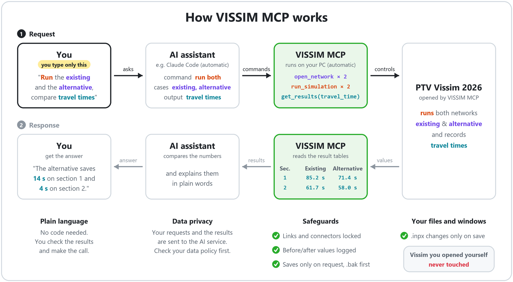
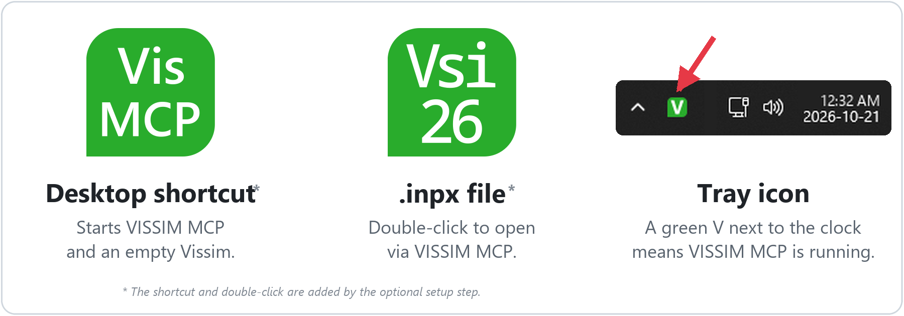

# VISSIM MCP

**English** · [한국어](README.ko.md) · [简体中文](README.zh-CN.md)

A local [MCP](https://modelcontextprotocol.io) server that lets an AI assistant such as Claude Code drive **PTV Vissim 2026** over COM, built for working on real project files without damaging them.

> **Built with AI, for one person's work.** The author built this with AI coding assistants to make their own day-to-day Vissim work easier, and added features as they were needed. It has only been tested on the author's own PC and projects, not on other setups. We recommend using it with the help of an AI assistant. Let it read this repository, check it against your Vissim version and environment, and fix what does not fit.

## Where this fits

The author's Vissim workflow has three stages. This repository publishes stage 2.

| Stage | What it does | In this repository |
|---|---|---|
| 1. Network building | Builds the Vissim network | Private |
| 2. **Conversational control (MCP)** | Lets an AI assistant open, edit, simulate and read results from a network | **Yes, the full source** |
| 3. Calibration and validation automation | — | Name only |

## How it works



## What it guarantees

- **It only drives the Vissim instance it launched itself.** It never attaches to a Vissim window you opened yourself, so the network you are editing there is never touched.
- **A protected list that cannot be switched off.** Creating, deleting or reshaping links and connectors is refused, and so are changes to reference points, units, traffic regulation and the gradient basis. The check runs before any COM call, so a blocked call never reaches Vissim.
- **It saves only when you ask.** Nothing is auto-saved. Every save first writes a `.bak` copy. If another Vissim process is running, the save is refused unless you confirm.
- **Every change is logged.** Each write returns before and after values and is appended to `changes.jsonl`. If you quit with unsaved changes, the server asks first and leaves a recovery copy.
- **It is local only.** It listens on `127.0.0.1`, and no setting binds it to another host.

> **Disclaimer.** This is an independent project and is not affiliated with or endorsed by PTV Group. "PTV" and "Vissim" are trademarks of PTV Planung Transport Verkehr GmbH. You need your own licensed copy of PTV Vissim. You are responsible for following your PTV license terms, including any terms about sending Vissim data or results to third-party services such as AI assistants. This repository contains no PTV software, documentation or example files. The icon pictures in this README are derived from the PTV Vissim 2026 icon and are shown only to identify the icons this tool draws on your PC.

## Status

- Tested with PTV Vissim 2026 (SP09) on Windows 11 and Python 3.12. Other Vissim versions are untested. The COM ProgID can be changed in the config. Run the probe (below) before trusting another version.
- Published as is, for reference. There is no support commitment, the interface may change without notice, and issues and pull requests may go unanswered.
- Distributed by `git clone` only. It is not on PyPI.

## Requirements

- Windows with a licensed **PTV Vissim 2026** installation (COM is Windows-only)
- Python 3.12+
- An MCP client that supports the streamable HTTP transport, for example [Claude Code](https://claude.com/claude-code)

## Install

```bash
git clone https://github.com/sn856/VISSIM_MCP.git
cd VISSIM_MCP
python -m pip install -e .
```

## First run

1. **Check COM once on your PC.** The probe creates an empty network, tries every call the server relies on and prints OK or the Vissim error for each. It never saves your network. Pass `--net` with a saved network to include simulation and result checks.

   ```bash
   python tools/com_probe.py --net C:\path\to\some\network.inpx
   ```

2. **Register the server with Claude Code (user scope, so every session sees it).**

   ```bash
   claude mcp add --scope user --transport http vissim http://127.0.0.1:8766/mcp
   ```

3. **Start the server.** It runs in the system tray with no console window. Vissim starts on the first command.

   ```bash
   python -m vissim_mcp
   ```

   Check it with `python -m vissim_mcp status`. To stop it, use the tray icon's quit item or `python -m vissim_mcp stop`.

## Opening files by double-click (optional)

COM cannot attach to a Vissim window you started yourself, so the way to keep every Vissim window controllable is to open files *through* the server. One command sets this up for your Windows user account:

```bash
python -m vissim_mcp install
```

It changes three things and records each one in `%LOCALAPPDATA%\vissim_mcp\install.json`:

- **Double-clicking an `.inpx`** opens it in the server's Vissim. If the server is not running, it is started. If another file is open there, you are asked before it is replaced, because Vissim discards unsaved changes without asking. Vissim's own "Open" entry stays in the right-click menu.
- **A desktop shortcut, "VISSIM MCP"**, starts the server with an empty Vissim. If the server's Vissim is already open, the shortcut brings that window to the front instead of starting another one.
- **A Startup-folder shortcut** starts the server when you sign in, so the assistant can connect as soon as a session opens.

### The three icons



| Icon | Where you see it | What it does |
|---|---|---|
|  | Desktop shortcut **VISSIM MCP** | Starts the server with an empty Vissim. If the server's Vissim is already open, brings that window to the front instead. |
|  | Every `.inpx` file in Explorer | Double-click opens the file in the server's Vissim and starts the server if needed. The right-click menu also has **Open with VISSIM MCP**, and Vissim's own "Open" still opens a file without the server. |
|  | System tray (notification area), while the server runs | Click: **Show status**. Right-click menu: **Show status**, **Open log folder**, **Quit server and VISSIM**. Quitting asks first if the open file has unsaved changes. |

These are the real icons as drawn from PTV Vissim 2026 (SP09). The tool builds them on your PC from the Vissim icon you have installed and ships no icon files: the purple background becomes green, the tray icon shows one large "V", the shortcut shows "Vis / MCP", and the `.inpx` icon keeps Vissim's own lettering ("Vsi 26"). Colour is not the only cue, because the lettering on each icon is different too. If the Vissim icon cannot be read, the tray falls back to a green circle with a "V".

`python -m vissim_mcp uninstall` removes exactly what `install.json` lists and nothing else. Vissim started from the Start menu is still a plain Vissim that the assistant cannot reach, so use the shortcut or a double-click instead.

## Using it

### Every working day

1. **Keep the tray icon running while you work.**  The tray icon *is* the server. If it is not there, the assistant has nothing to talk to. After `install` it starts by itself when you sign in. Otherwise start it with the desktop shortcut or `python -m vissim_mcp`. Quitting from the tray also closes the server's Vissim, and it asks first if there are unsaved changes.
2. **Open Vissim through the server.**
   -  To work on a network, double-click its green `.inpx` file, the same way you always open a network.
   -  To start from an empty Vissim, run the **VISSIM MCP** desktop shortcut. Vissim opens and the assistant can control it.
   - Do not open Vissim from the Start menu or Vissim's own icon. That Vissim works normally, but the assistant cannot reach it.
3. **Connect Claude Code to the server.** You register it once (`claude mcp add ...`, see [First run](#first-run)). After that, open Claude Code in any folder and type `/mcp`. `vissim` should show as connected. If you started the server after the session opened, reconnect `vissim` from the same `/mcp` screen.
4. **Talk to the assistant** (examples below). When you are done, say "save", then quit from the tray icon.

### What to say

Talk to the assistant in plain language, for example:

1. "Open `C:\projects\corridor\network.inpx`."
2. "Set the volume of vehicle input 3 to 2000 veh/h."
3. "Run the simulation for 10 minutes."
4. "Show me the travel times."
5. "Save."

The file changes only at step 5, and a `.bak` copy is written first.

The server refuses an action and says why when:

- you open another file while one is open (answer "discard and open" to override);
- you save while another Vissim window is open (close it or confirm with `force`);
- you change something while a simulation is running (stop it first);
- you try to change a protected item (not possible; only the config file can change the list).

## Tools (20)

| Group | Tools |
|---|---|
| Session | `vissim_status`, `open_network`, `save_network` |
| Objects | `list_object_types`, `describe_attributes`, `list_objects`, `get_attributes`, `set_attributes`, `create_object`, `delete_object` |
| Simulation | `configure_simulation`, `configure_evaluation`, `run_simulation`, `stop_simulation` |
| Results | `get_results`, `list_result_files`, `read_result_file` |
| History | `get_change_log` |
| Screen | `set_view`, `capture_view` |

The server can create and delete vehicle inputs, vehicle compositions, static routes, desired speed decisions, reduced speed areas, data collection points and measurements, travel time measurements, queue counters and parking objects. Every response carries a `state` block with the open file, the count of unsaved writes and the simulation state. See [docs/contracts.md](docs/contracts.md) for arguments and return shapes.

`python tools/mcp_call.py` calls the same tools from the command line, which helps when an assistant session has lost its MCP connection.

## Configuration

The config file is `config/vissim_mcp.json`. Use `--config` to pass another one.

| Key | Meaning |
|---|---|
| `vissim.progid` | COM ProgID, `Vissim.Vissim.26` for Vissim 2026 |
| `port` | Local port (default 8766) |
| `protected` | The protected list: `{type, ops, attrs}` entries. `attrs: ["*"]` means every attribute, and a trailing `*` matches a prefix. |
| `protected_roots` | Folders whose files get their `.bak` written to `log_root/backup/` instead of next to the file, so data folders do not fill up with copies |
| `log_root` | Where logs, backups, recovery copies, layouts and screenshots go (default `runs/mcp`) |

Other tunable values and their defaults are in [`src/vissim_mcp/config.py`](src/vissim_mcp/config.py).

## What the server writes

- The `.inpx` open in the server's Vissim, and only when `save_network` is called or you choose "save and quit" when stopping the server, with a `.bak` written first.
- Everything else goes under `log_root`: `server.log`, `changes.jsonl`, `backup/`, `recovery/`, `layouts/` (view-layout copies; your `.layx` is never modified), `captures/` (PNG screenshots) and `launcher.log` (one line per double-click).
- `install` writes only to `%LOCALAPPDATA%\vissim_mcp\`, this tool's keys under your account's `.inpx` file type in the registry, one desktop shortcut and one Startup-folder shortcut.

Simulation result folders next to your network are written by Vissim itself.

## Not in scope

- Building networks: drawing links and connectors. Draw them in Vissim or generate them with your own tool, then use the server for demand, routes, evaluation and results.
- Attaching to a Vissim window you started yourself (COM does not allow it; see [docs/engineering-notes.md](docs/engineering-notes.md)).
- Authentication. Binding to `127.0.0.1` is the only fence, so do not run it on a shared PC.

## Feature status

- **Stage 1: Network building**: private
- **Stage 2: MCP control**: published in this repository
  - Open and save networks (with a .bak backup before saving): done
  - Query objects and change attributes (returns before and after values): done
  - Create and delete objects (vehicle inputs, routes, desired speeds, measurement points, etc.): done
  - Simulation settings, run and stop: done
  - Evaluation settings and reading results (result tables, .att files): done
  - Change log (changes.jsonl): done
  - View settings and screen capture: done
  - Protected list (blocks changes to links, connectors, reference points and units): done
  - Tray icon, desktop shortcut, opening .inpx files by double-click: done
  - Signal phasing and timing input: in progress
  - Traffic volume input: in progress
- **Stage 3: Calibration and analysis**: in progress
  - GEH check and validation against field survey data: in progress
  - Analysis reports per alternative: in progress

No dates are set for the work in progress, and the scope and names may change.

## Development

```bash
python -m pytest -q
```

All tests run without Vissim, using fake COM objects. Design notes:

- [docs/architecture.md](docs/architecture.md)
- [docs/engineering-notes.md](docs/engineering-notes.md) (COM pitfalls observed in Vissim 2026)
- [docs/adr/](docs/adr/)

## License

[MIT](LICENSE)
