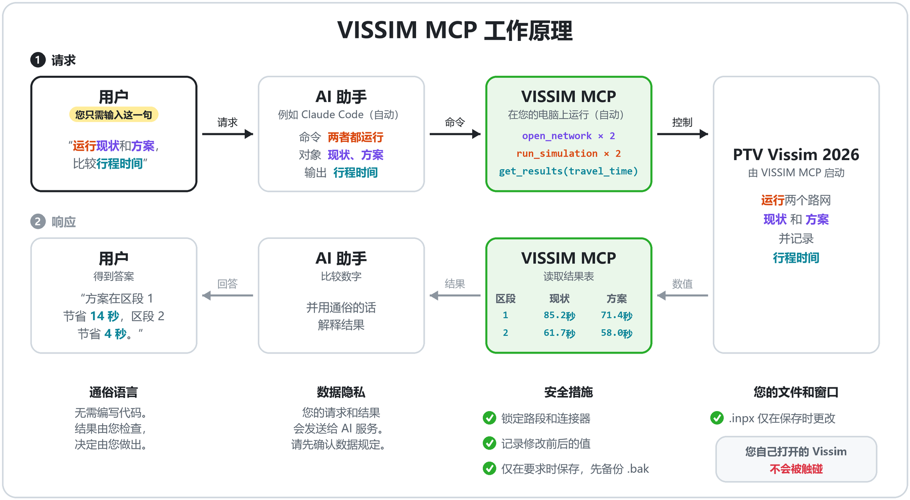

# VISSIM MCP

[English](README.md) · [한국어](README.ko.md) · **简体中文**

一个本地 [MCP](https://modelcontextprotocol.io) 服务器，让 Claude Code 等 AI 助手通过 COM 操作 **PTV Vissim 2026**。它面向真实的项目文件，设计上避免损坏这些文件。

> **用 AI 做成、供个人工作使用的工具。** 作者为了让自己日常的 Vissim 工作更轻松，借助 AI 编程助手编写了它，功能也是按需逐步添加的。它只在作者自己的电脑和项目上测试过，没有在其他环境中测试。建议在 AI 助手的帮助下使用：让助手阅读本仓库，检查它是否适合您的 Vissim 版本和环境，并修改不适合的部分。

## 在整体流程中的位置

作者的 Vissim 工作流程分为三个阶段。本仓库公开的是第 2 阶段。

| 阶段 | 内容 | 本仓库 |
|---|---|---|
| 1. 路网构建 | 生成 Vissim 路网 | 不公开 |
| 2. **对话式操作（MCP）** | AI 助手打开、修改路网，运行仿真并读取结果 | **完整源代码** |
| 3. 标定与验证自动化 | — | 仅名称 |

## 工作原理



## 保证事项

- **只操作自己启动的 Vissim。** 它从不连接您自己打开的 Vissim 窗口，因此您在那里编辑的路网不会被改动。
- **无法关闭的保护列表。** 创建、删除或改变路段（link）和连接器（connector）形状的操作会被拒绝，修改参考点、单位、交通规则和坡度基准也会被拒绝。检查在任何 COM 调用之前进行，被拦截的调用不会到达 Vissim。
- **只在您要求时保存。** 没有自动保存。每次保存前先写一份 `.bak` 副本。如果有其他 Vissim 进程在运行，除非您确认，否则拒绝保存。
- **记录每一次修改。** 每次写入都会返回修改前后的值，并追加到 `changes.jsonl`。如果在有未保存修改时退出，服务器会先询问，并留下恢复副本。
- **仅限本地。** 只监听 `127.0.0.1`，没有任何设置可以绑定到其他地址。

> **免责声明。** 本项目是独立项目，与 PTV Group 无关，也未获其认可。"PTV" 和 "Vissim" 是 PTV Planung Transport Verkehr GmbH 的商标。您需要自己拥有正版 PTV Vissim 许可。遵守 PTV 许可条款（包括有关将 Vissim 数据或结果发送给 AI 助手等第三方服务的条款）是您自己的责任。本仓库不包含任何 PTV 软件、文档或示例文件。本 README 中的图标图片由 PTV Vissim 2026 图标生成，仅用于让您认出本工具在您电脑上绘制的图标。

## 状态

- 在 Windows 11、Python 3.12 和 PTV Vissim 2026 (SP09) 上测试过。其他 Vissim 版本未测试。COM ProgID 可在配置中修改。在其他版本上使用前，请先运行下文的检查工具。
- 按原样公开，仅供参考。不承诺支持，接口可能不经通知而变更，issue 和 pull request 可能得不到回复。
- 仅通过 `git clone` 分发，未发布到 PyPI。

## 环境要求

- 安装了正版 **PTV Vissim 2026** 的 Windows（COM 仅限 Windows）
- Python 3.12 及以上
- 支持 streamable HTTP 传输的 MCP 客户端，例如 [Claude Code](https://claude.com/claude-code)

## 安装

```bash
git clone https://github.com/sn856/VISSIM_MCP.git
cd VISSIM_MCP
python -m pip install -e .
```

## 首次运行

1. **在您的电脑上检查一次 COM。** 检查工具会新建一个空路网，逐一尝试服务器依赖的每个调用，并对每项输出 OK 或 Vissim 的错误信息。它不会保存您的路网。用 `--net` 传入一个已保存的路网，还会检查仿真和结果。

   ```bash
   python tools/com_probe.py --net C:\path\to\some\network.inpx
   ```

2. **在 Claude Code 中注册服务器**（user 范围，所有会话都能看到）。

   ```bash
   claude mcp add --scope user --transport http vissim http://127.0.0.1:8766/mcp
   ```

3. **启动服务器。** 它在系统托盘中运行，没有控制台窗口。Vissim 在第一条命令时启动。

   ```bash
   python -m vissim_mcp
   ```

   用 `python -m vissim_mcp status` 查看状态。停止时使用托盘图标的退出菜单或 `python -m vissim_mcp stop`。

## 双击打开文件（可选）

COM 无法连接到您自己启动的 Vissim 窗口，因此要让每个 Vissim 窗口都可被操作，就需要*通过*服务器打开文件。一条命令即可为当前 Windows 用户账户完成设置：

```bash
python -m vissim_mcp install
```

它会修改三处，并把每一处记录在 `%LOCALAPPDATA%\vissim_mcp\install.json` 中：

- **双击 `.inpx`** 会在服务器的 Vissim 中打开它。服务器未运行时会自动启动。如果那里已经打开了其他文件，替换前会询问您，因为 Vissim 会不经询问就丢弃未保存的修改。Vissim 自己的"打开"项仍保留在右键菜单中。
- **桌面快捷方式"VISSIM MCP"**会以空 Vissim 启动服务器。如果服务器的 Vissim 已经打开，快捷方式会把该窗口切到前台，而不是再启动一个。
- **启动文件夹快捷方式**会在您登录时启动服务器，让助手在会话一打开时就能连接。

### 三个图标


| 图标 | 出现位置 | 作用 |
|---|---|---|
|  | 桌面快捷方式 **VISSIM MCP** | 以空 Vissim 启动服务器。如果服务器的 Vissim 已经打开，则把该窗口切到前台，而不是再启动一个。 |
|  | 资源管理器中的所有 `.inpx` 文件 | 双击会在服务器的 Vissim 中打开文件，必要时先启动服务器。右键菜单中还有 **Open with VISSIM MCP**，Vissim 自己的"打开"仍可不经服务器打开文件。 |
|  | 服务器运行期间的系统托盘（通知区域） | 单击：**Show status**（查看状态）。右键菜单：**Show status**、**Open log folder**（打开日志文件夹）、**Quit server and VISSIM**（退出服务器和 Vissim）。如有未保存的修改，退出前会先询问。 |

以上是根据 PTV Vissim 2026 (SP09) 图标绘制的实际图标。本工具不附带任何图标文件，而是在您的电脑上根据已安装的 Vissim 图标即时绘制：紫色背景变为绿色，托盘图标显示一个大"V"，快捷方式显示"Vis / MCP"两行，`.inpx` 图标保留 Vissim 原有的文字（"Vsi 26"）。各图标上的文字也不同，因此不必只靠颜色区分。如果无法读取 Vissim 图标，托盘会改用带"V"的绿色圆形图标。

`python -m vissim_mcp uninstall` 只删除 `install.json` 中列出的内容，不多删任何东西。从开始菜单启动的 Vissim 仍是助手无法访问的普通 Vissim，请改用快捷方式或双击。

## 使用方法

### 日常工作

1. **工作期间保持托盘图标运行。**  托盘图标就是服务器。没有它，助手就无处连接。执行过 `install` 后，它会在您登录时自动启动；否则请用桌面快捷方式或 `python -m vissim_mcp` 启动。从托盘退出时，服务器启动的 Vissim 也会一起关闭；如有未保存的修改，会先询问。
2. **通过服务器打开 Vissim。**
   -  处理路网时，像平常一样双击绿色的 `.inpx` 文件即可。
   -  要从空 Vissim 开始，运行桌面快捷方式 **VISSIM MCP**。Vissim 会打开，并处于助手可以操作的状态。
   - 不要从开始菜单或 Vissim 自己的图标打开。那样打开的 Vissim 可以正常使用，但助手无法访问。
3. **把 Claude Code 连接到服务器。** 只需注册一次（`claude mcp add ...`，见[首次运行](#首次运行)）。之后在任意文件夹打开 Claude Code，输入 `/mcp`，确认 `vissim` 显示为已连接（connected）。如果是在会话打开之后才启动服务器，请在同一个 `/mcp` 界面中重新连接 `vissim`。
4. **用语言向助手下指令**（见下例）。完成后说"保存"，然后从托盘图标退出。

### 可以这样说

用平常的语言对助手下指令，例如：

1. "打开 `C:\projects\corridor\network.inpx`。"
2. "把车辆输入 3 的流量改为 2000 辆/小时。"
3. "仿真运行 10 分钟。"
4. "给我看行程时间。"
5. "保存。"

文件只在第 5 步才会改变，并且会先写一份 `.bak` 副本。

在以下情况，服务器会说明原因并拒绝操作：

- 已有文件打开时打开另一个文件（回答"放弃并打开"即可强制打开）；
- 有其他 Vissim 窗口打开时保存（关闭该窗口或用 `force` 确认）；
- 仿真运行中修改内容（请先停止）；
- 修改受保护的项目（不可能；只能通过配置文件修改列表）。

## 工具（20 个）

| 分组 | 工具 |
|---|---|
| 会话 | `vissim_status`、`open_network`、`save_network` |
| 对象 | `list_object_types`、`describe_attributes`、`list_objects`、`get_attributes`、`set_attributes`、`create_object`、`delete_object` |
| 仿真 | `configure_simulation`、`configure_evaluation`、`run_simulation`、`stop_simulation` |
| 结果 | `get_results`、`list_result_files`、`read_result_file` |
| 历史 | `get_change_log` |
| 画面 | `set_view`、`capture_view` |

服务器可以创建和删除车辆输入、车辆构成、静态路径、期望速度决策点、减速区、数据采集点与测量、行程时间测量、排队计数器以及停车对象。每个响应都带有 `state` 块，包含打开的文件、未保存写入数和仿真状态。参数和返回格式见 [docs/contracts.md](docs/contracts.md)（英文）。

`python tools/mcp_call.py` 可在命令行中调用同样的工具，在助手会话的 MCP 连接断开时很有用。

## 配置

配置文件为 `config/vissim_mcp.json`。用 `--config` 指定其他文件。

| 键 | 含义 |
|---|---|
| `vissim.progid` | COM ProgID，Vissim 2026 为 `Vissim.Vissim.26` |
| `port` | 本地端口（默认 8766） |
| `protected` | 保护列表：`{type, ops, attrs}` 条目。`attrs: ["*"]` 表示所有属性，末尾的 `*` 表示前缀匹配。 |
| `protected_roots` | 这些文件夹下的文件，其 `.bak` 写到 `log_root/backup/` 而不是文件旁边，避免数据文件夹被副本填满 |
| `log_root` | 日志、备份、恢复副本、布局和截图的存放位置（默认 `runs/mcp`） |

其他可调参数及其默认值见 [`src/vissim_mcp/config.py`](src/vissim_mcp/config.py)。

## 服务器写入的文件

- 服务器 Vissim 中打开的 `.inpx`：仅在调用 `save_network` 或停止服务器时选择"保存并退出"时写入，并先写 `.bak`。
- 其他所有内容都在 `log_root` 下：`server.log`、`changes.jsonl`、`backup/`、`recovery/`、`layouts/`（视图布局副本；您的 `.layx` 不会被修改）、`captures/`（PNG 截图）和 `launcher.log`（每次双击一行）。
- `install` 只写入 `%LOCALAPPDATA%\vissim_mcp\`、注册表中您账户 `.inpx` 文件类型下本工具的键、一个桌面快捷方式和一个启动文件夹快捷方式。

路网旁边的仿真结果文件夹由 Vissim 自己写入。

## 不包括的内容

- 路网构建：绘制路段和连接器。请在 Vissim 中绘制或用您自己的工具生成，然后用本服务器处理需求、路径、评价和结果。
- 连接到您自己启动的 Vissim 窗口（COM 不允许；见 [docs/engineering-notes.md](docs/engineering-notes.md)）。
- 身份验证。绑定 `127.0.0.1` 是唯一的防护，请不要在多人共用的电脑上运行。

## 功能现状

- **阶段 1：路网构建**：不公开
- **阶段 2：MCP 控制**：已在本仓库公开
  - 打开和保存路网（保存前先备份 .bak）：已完成
  - 查询对象和修改属性（返回修改前后的值）：已完成
  - 创建和删除对象（车辆输入、路径、期望速度、检测点等）：已完成
  - 仿真设置、运行和停止：已完成
  - 评价设置和读取结果（结果表、.att 文件）：已完成
  - 变更记录（changes.jsonl）：已完成
  - 视图设置和截图：已完成
  - 保护列表（禁止修改路段、连接器、参考点和单位）：已完成
  - 托盘图标、桌面快捷方式、双击打开 .inpx：已完成
  - 信号相位与配时输入：开发中
  - 交通量输入：开发中
- **阶段 3：标定与分析**：开发中
  - GEH 检验及现场调查结果验证：开发中
  - 各方案分析报告：开发中

开发中功能的完成时间尚未确定，范围和名称可能会变化。

## 开发

```bash
python -m pytest -q
```

所有测试都使用模拟的 COM 对象运行，不需要 Vissim。设计文档（英文）：

- [docs/architecture.md](docs/architecture.md)
- [docs/engineering-notes.md](docs/engineering-notes.md)（在 Vissim 2026 中观察到的 COM 陷阱）
- [docs/adr/](docs/adr/)

## 许可证

[MIT](LICENSE)
